# AVALightWave

[](https://github.com/Harlock123/AVALightWave/actions/workflows/build.yml)

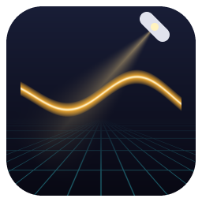

A cross-platform **re-imagining of classic LightWave Layout** (versions 4 and 5), the scene, animation and render
program that shipped beside LightWave Modeler, built with .NET 10 and Avalonia. It's **inspired by** the original's
way of working (the Layout view with its edit modes and mouse modes, Selected Item, the row of panels across the top,
numeric requesters, the timeline and its keys, Replace Object, and a hub joining it to the modeler) and stands on the
engine of [AVA Modeler](https://github.com/Harlock123/AVAModeler), its companion modeler, which this repository
carries as a git submodule: the same scene model, TCB animation, bones with inverse kinematics, paths, deformation,
LightWave scene and object files, ray tracer, movie output and AI tools, in a program of its own.

Classic LightWave was two programs from two authors: Allen Hastings's Layout (which grew from his VideoScape 3D) and
Stuart Ferguson's Modeler (from his Modeler 3D), linked by a hub. AVA Modeler recreates the modeler, with a Layout
workspace of its own; AVALightWave is the standalone Layout, and the hub joins the two again.

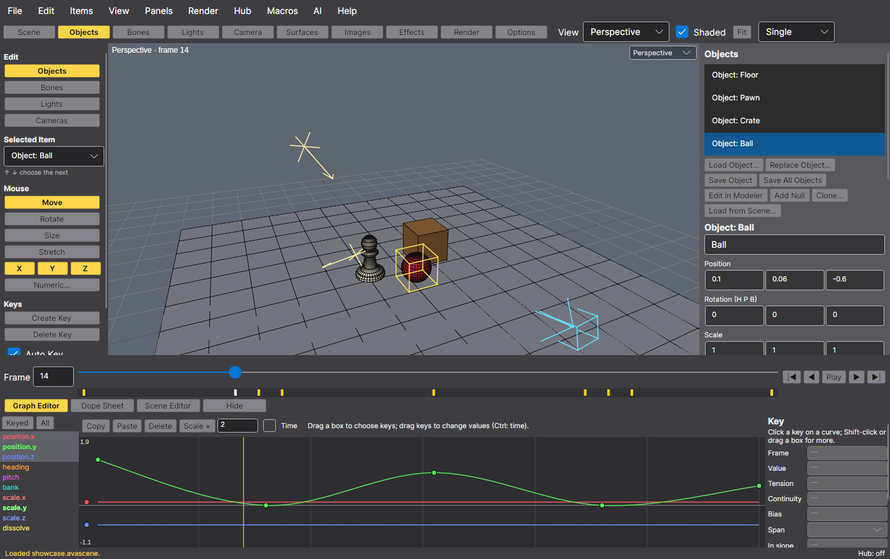

## Features

### A Layout of its own

| Classic Layout 4/5 | AVALightWave |
|---|---|
| The Layout view: Camera, Perspective, Top, Front (LightWave's Back), Side and Light views | The same six (View menu, the view list, keys 1 to 6); the camera view with its frame and safe areas; the light view looks through the chosen light (a spot's cone wide), for aiming |
| One view (LightWave's later versions: viewport layouts) | View › Layout (Ctrl+1 to Ctrl+4, or the toolbar's list): Single, Side by Side (Perspective + Camera), Stacked (Top over Camera) and Quad (Top, Perspective, Front, Camera). Each pane has its own view type (the list in its corner) and its own zoom and pan; the last pane clicked is outlined and takes 1 to 6; A frames every pane. Remembered between runs. The views are drawn with OpenGL (the engine's renderer), falling back to software drawing where OpenGL can't start |
| Edit: Objects, Bones, Lights, Cameras | The Edit buttons (Shift+O, B, L, C): the view picks only that kind (nulls count as objects), and choosing an item of another kind anywhere switches to its mode |
| Selected Item pop-up, arrow keys | Selected Item lists the mode's items; ↑ ↓ step through them |
| Mouse: Move, Rotate, Size, Stretch, with X, Y, Z | The Mouse buttons (T, Y, H, Shift+H) and the X, Y, Z buttons limiting the axes (heading, pitch, bank when rotating); the right button works the third axis (depth, bank, Z) |
| Numeric requester | Numeric (N): position, rotation and scale at the frame, typed, one undo step |
| Create Key, Delete Key, Auto Key | The same (Enter, Delete), keyed by the engine's one keying rule |
| Clone Item | Items › Clone Item (and the panels' Clone buttons): copies of an object (with its bones), light, camera or null with its motion, as many as asked, each moved, turned, sized and delayed in time from the one before ("Ball (2)", "Ball (3)"…); one undo step |
| Load Motion, Save Motion; motion plug-ins | Items › Load Motion and Save Motion: an item's nine channels as a LightWave motion file (.mot, version 1 from Layout 4/5 and version 3 from LightWave 6 on are read; version 3 written), so one item's motion goes onto another. Items › Motion Options: motion modifiers in the spirit of Layout 5's motion plug-ins: Lag (follow another item some frames behind), Jitter, Cycle (Layout 5's Cyclist: one item's channel drives another's keys) and Oscillate |
| The frame slider and play controls | The timeline with the chosen item's key marks, a frame box, first, back, play, on, last (Home, ←, Space, →, End) |
| Scene, Objects, Bones, Lights, Camera, Surfaces, Images, Effects, Record, Options panels | Scene, Objects, Bones, Lights, Camera, Surfaces, Images, Effects, Render and Options, re-imagined as panels docked on the right (the buttons across the top), not modal requesters |
| Scene Overview (later the Scene Editor) | The Scene Editor (E): the hierarchy, an eye to show or hide each item, a lock to keep the mouse off it, and its keys across the frames |
| Motion graph | The engine's graph editor (G): every curve of the chosen item (motion, intensity, flare intensity, zoom, dissolve, morph weights…), several at once; keys chosen by click, Shift and box across curves, dragged in value or time; per key tension, continuity, bias and a span: TCB, Linear, Stepped or Bezier (in and out slopes); before and after behaviours (Reset, Constant, Repeat, Oscillate, Offset Repeat, Linear); Copy, Paste (onto another curve too), Delete and Scale time. And its dope sheet (D) |
| Load Scene, Save Scene, Save All Objects | .lws (LightWave 4/5 and later) and .avascene (everything, meshes inside); saving an .lws first saves any object with no file of its own, as LWOB, in an Objects folder beside it |
| Load From Scene | File › Load from Scene: another .lws or .avascene's objects (with their bones), nulls, and if wanted its lights and cameras, with their hierarchy and motion, into the open scene; names already taken become "Ball (2)"; one undo step |
| (crash recovery) | The scene is auto-saved every few minutes while it has changes (in AVALightWave's app-data folder, never over your file); if AVALightWave didn't close properly, the next start offers it back |
| Load Object, Replace Object | Load as many objects as you like (LWOB, LWO2, OBJ, GEO, glTF/GLB, STL); Replace Object swaps an item's geometry for another file's, keeping its motion, parent and bones |
| Parenting, pivots, nulls | In each item's settings; nulls from the Items menu or the Objects panel |
| Bones, IK, Skelegons | The engine's bones (Add Bone; Items › Skelegons → Bones turns a loaded object's skelegons into bones in one step), full-time IK with goals, limits, locks and anchors |
| Metamorph (morph target, morph amount envelope) | The Objects panel's Morph targets: an object blends toward another object file's shape (or another object's) with the same points, by its keyable morph.<name> weight, shown as a percentage at the frame; several add up; in the views, previews and renders |
| Object Dissolve | The Objects panel's Dissolve % (the keyable `dissolve` channel): the renderer lets what's behind show through, and the views draw it with screen-door transparency |
| Lights, Camera | Distant, point, spot and area lights with soft shadows; zoom, resolution presets, depth of field and motion blur |
| (camera bookmarks) | The Camera panel's Bookmarks: Save View keeps where the camera is, which way it looks and its zoom under a name; pressing a bookmark puts the camera back there (keyed at the frame if it's animated). Kept in .avascene scenes; undoable |
| Lens Flare, Volumetric lights, Shadow Map | The Lights panel: a lens flare (glow, halo ring, star streaks, fading behind objects, off screen and with distance; its intensity keyable), a volumetric beam in the air (spot and point lights; intensity, quality, length, shadowed or not), and the shadow type: ray traced, a shadow map (size, fuzziness; much faster for soft shadows) or off |
| Images panel; Effects › Compositing | The Images panel: pictures and numbered sequences (sky0001.png…) with a frame offset and looping, for compositing and textures (a texture whose file is a sequence plays it in renders). The Effects panel's Compositing: a background image where the camera sees nothing, and a foreground image over the render, keyed by a colour range or alpha, with a dissolve |
| Make Preview | Render › Make Preview (Shift+P): a wireframe or shaded flipbook of a range of frames drawn as the view draws them (not ray traced), through the camera or the active view, made in the background, then played at the scene's frame rate with loop and stepping, and saved as numbered PNGs, MP4 or GIF (with ffmpeg) |
| ScreamerNet (network rendering) | Render › Render Queue: batch rendering of scene jobs, and a render farm in a shared folder with headless render nodes (`AVALightWave --render-node <folder>`) on this or other machines; below |
| ARexx/LScript macros | Lua scene macros on AVA Modeler's macro engine and sandbox (the Macros menu, your macro folder); below |
| Rendering | The engine's ray tracer (F9) with ambient occlusion, environment lighting, depth of field and motion blur; Render Animation (F10) to PNG frames and, with ffmpeg, MP4 and GIF; glTF export |
| The hub | A live link with AVA Modeler (below) |

Every change to the scene (a drag, a value typed, a key, a panel setting, a surface, Replace Object, an update from
AVA Modeler, an AI agent's call) is one undo step: Ctrl+Z, and Ctrl+Shift+Z or Ctrl+Y.

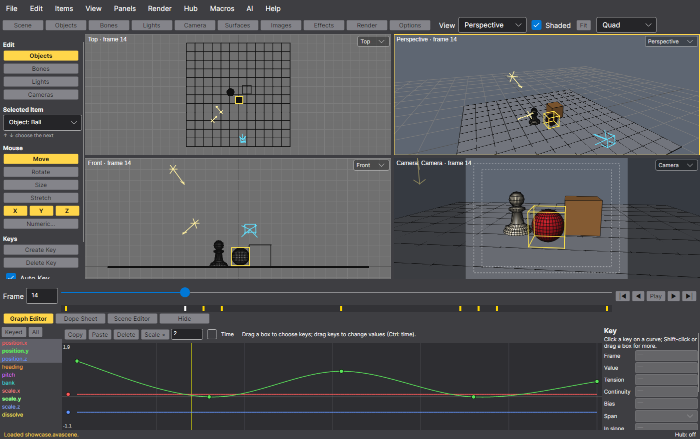

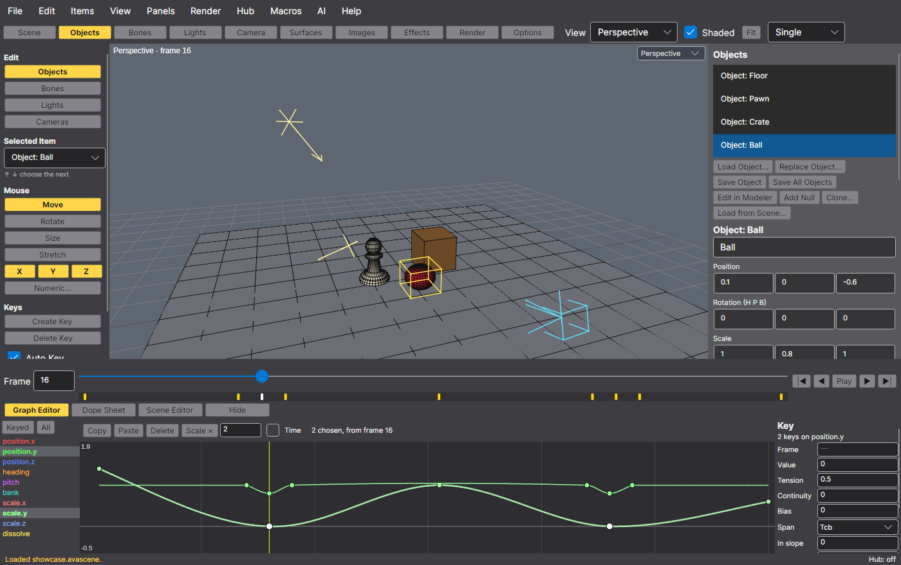

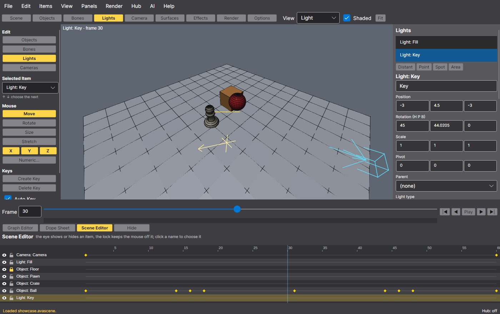

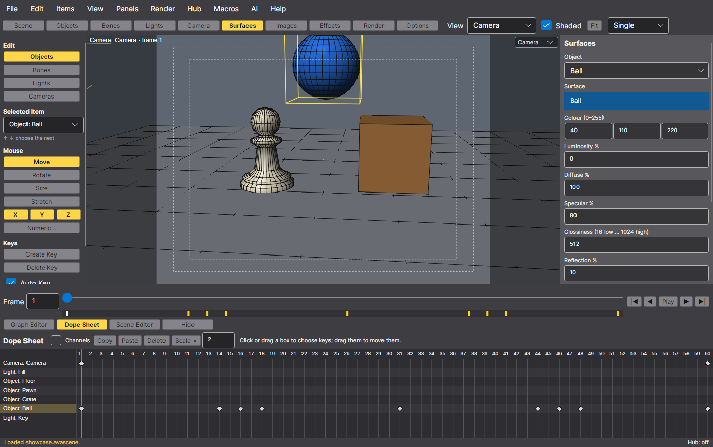

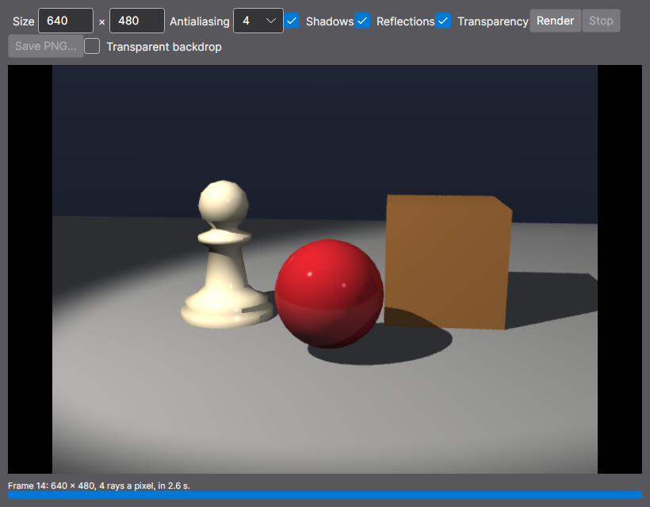

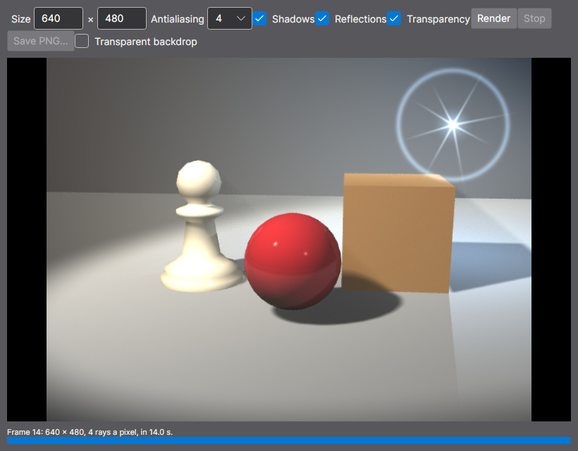

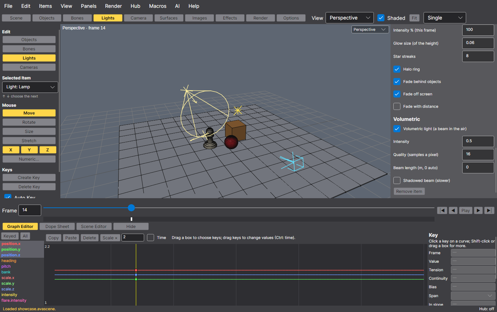

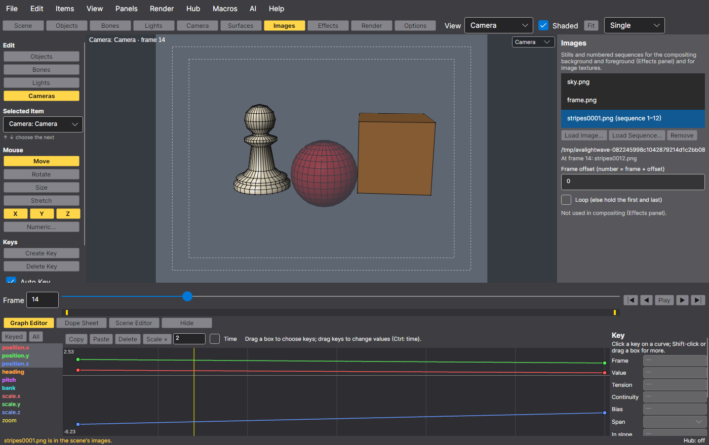

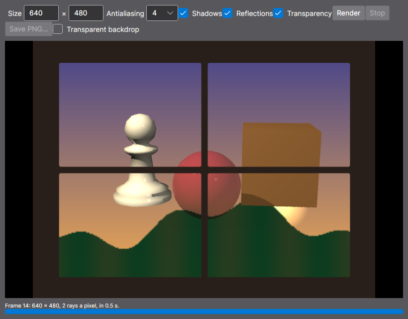

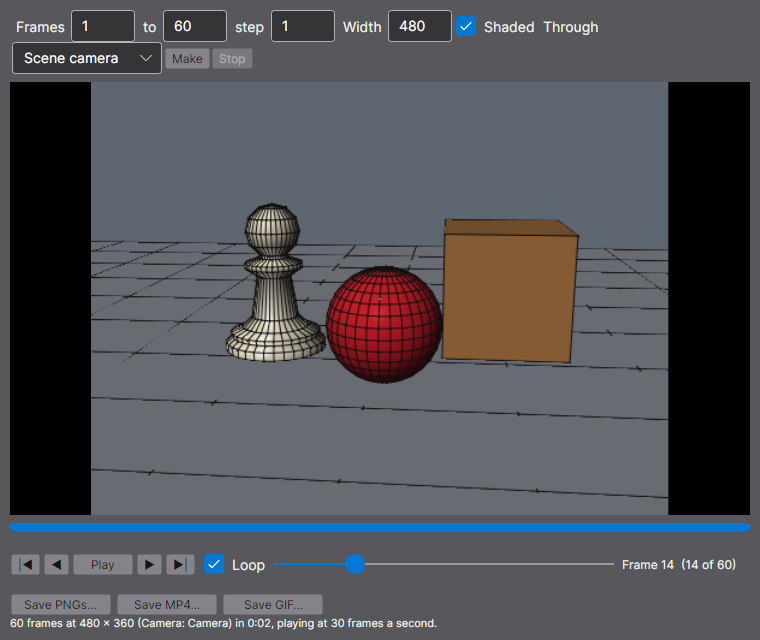

### Batch and network rendering

Render › Render Queue sends the scene as it is now (a self-contained copy, its images included) as a job with its
frames, size and samples. Jobs go to the local queue or to a **render farm folder**, in the spirit of ScreamerNet: a
folder on this computer or on a network share that every render machine can reach. **Render nodes** work it frame by
frame: the window's own (Start Local Rendering) and any number of headless ones on this or other machines:

```bash
AVALightWave --render-node /mnt/farm             # a render node: renders frames of the folder's jobs until stopped
AVALightWave --render-node /mnt/farm --once      # until nothing is left, then exits (also --name, --threads, --poll)
```

Each node claims frames the others haven't (a claim file made with create-new, which is atomic on local disks and
SMB and NFS shares), writes the frame, then a done file; a node that dies has its frames taken over after two minutes.
The queue shows each job's frames done, its state and the nodes on it; Cancel, Up/Down and Remove Finished manage it.
There's **no network listener**: the shared folder is the whole protocol. Nodes read only what's inside each job's
folder (every path resolved, links followed, and anything outside refused) and run nothing from it.

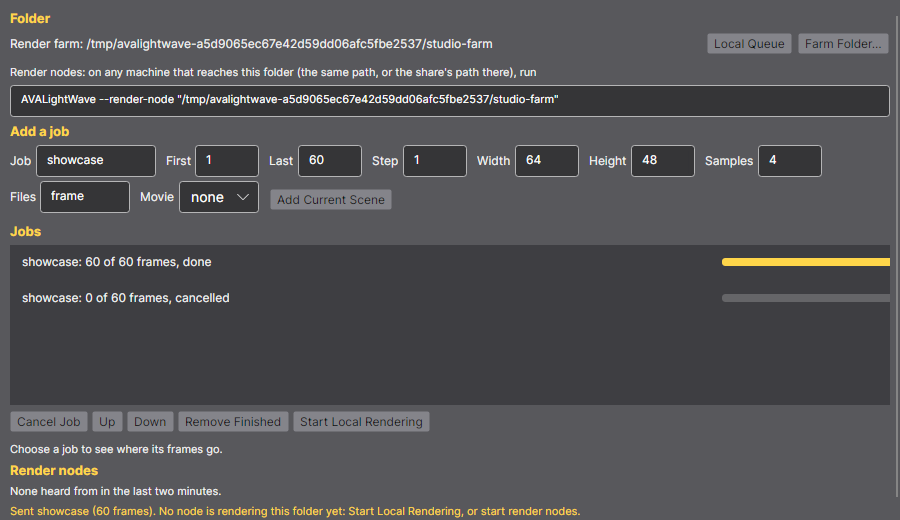

### Macros

Macros › Run Macro runs a Lua script on the scene, on AVA Modeler's macro engine and in its sandbox (no os, io or
require; stopped after 30 seconds). A whole macro is one undo step, and one that fails leaves the scene as it was. The
Macros menu lists the `.lua` files in your macro folder (`macros` in AVALightWave's settings folder) and shows the
reference: `items`, `frame`, `frames`, `addobject`, `addnull`, `addlight`, `addcamera`, `remove`, `select`,
`rename`, `parent`, `setpos`/`setrot`/`setscale` (keys at a frame), `getpos`/`getrot`/`getscale`, `key` (with
Tension, Continuity, Bias and Span), `unkey`, `get`, `channels`, `light`, `clone`, `render` and `print`.

```lua
local ball = addobject("objects/ball.lwo")
for f = 1, 60, 10 do key(ball, "position.y", f, math.abs(math.sin(f / 10)) * 2) end
clone(ball, 3, {1.5, 0, 0}, 5)      -- three more, each 1.5 m along and 5 frames later
```

### The hub: AVALightWave and AVA Modeler together

As the original package's hub did, AVALightWave and AVA Modeler link up while both are running, over a local pipe that
only your own programs can open (a Unix socket on Linux and macOS, a named pipe on Windows; no network). It's on in
both unless you turn it off (Options › Link with AVA Modeler here; Edit › Preferences in AVA Modeler).

- **Edit in Modeler** (Ctrl+E, the Hub menu, the Objects panel): the chosen object opens in AVA Modeler. If AVA Modeler
  isn't running, it's started with the object, found beside AVALightWave, in a sibling folder, on the PATH, through
  `AVAMODELER_PATH`, or where Options says. An object with unsaved changes (or no file) goes as a copy, in the `hub`
  folder of AVALightWave's settings (readable only by you). AVA Modeler won't open it over unsaved work of its own,
  and says so.
- **Saving it in AVA Modeler** (Ctrl+S) updates it here at once, keeping its motion, parent and bones, as one undo step
  ("Update pawn from AVA Modeler"). A link ties the two, so even a Save As under a new name finds its way back; a save
  of any file the scene uses updates its objects too.
- **Send to AVALightWave** (AVA Modeler's File menu) puts AVA Modeler's object in this scene, or updates the one it
  was sent as before (starting AVALightWave with it if need be).
- **Live sync**: while you model a linked object in AVA Modeler, its changes arrive here a moment after you stop (an
  unsaved copy through AVA Modeler's hub folder; your object keeps its own file and is marked as changed), as one undo
  step for the whole burst. Saving in AVA Modeler updates it as before.
- **The hub light** (the right of the status line) says whether AVA Modeler is there, the object linked and the last
  update: "Hub: AVA Modeler connected · linked pawn · synced 14:02:11", "Hub: on (AVA Modeler not running)" or
  "Hub: off". It's looked at every few seconds, off the window's thread.
- Either program works alone: when the other isn't there, nothing waits more than a moment.

### AI agents and the AI Chat

AVALightWave carries AVA Modeler's MCP server and AI Chat in a **Layout** configuration: the scene, objects,
lights, cameras, keys, bones and render tools, plus tools of its own that make objects in the scene with the engine's
modeling tools (`make_object` for ready-made shapes, `build_object` and `edit_object` for anything else), so a scene
needs no files. An object can still go to AVA Modeler with `edit_in_modeler`. Agents see the same scene the person
does, and every call they make is one undo step. `AI_SCENES.md` is the plan for building whole animated scenes from a
description.

- **The AI Chat** (F4, AI › Chat with Claude): the engine's chat panel, here staging, lighting and animating. It talks
  to Claude through your own Anthropic API key, or to a local or self-hosted model through an OpenAI-compatible API,
  with exactly AVA Modeler's rules: the key comes from `ANTHROPIC_API_KEY` or an owner-only `anthropic-api-key` file
  beside AVALightWave's `preferences.json` (a gateway's key only from its own file), is never shown beyond a mask, logged
  or saved in a chat; chat history is off until you turn it on, and then kept owner-only in `chats/`. A line under the
  input shows the chat's tokens and estimated cost as they're used, each turn gets a tag with its requests and cost,
  and Setup… has the prices, today's and this month's totals (in `chat-usage.json`) and a budget that stops a chat.
- **Outside agents**: with Options › Allow AI agents on, `AVALightWave --mcp --attach` connects an agent (Claude Code,
  say) to the open window through AVALightWave's own local pipe; `AVALightWave --mcp` serves a headless scene of its
  own.
- **Scenes from a description**: ask for "a rocket launching from a pad with smoke, the camera tilting up after it"
  and an agent plans it, builds it with `build_scene` (objects made in the scene, a lights rig, the motion and the
  camera, one undo step), fixes what `check_shot` finds, and renders. `AI_SCENES.md` describes the design.

#### Setting up Claude Code

Use the downloaded program (or a build: `dotnet build -c Release`, then `src/AVALightWave/bin/Release/net10.0/AVALightWave`).
Don't use `dotnet run` for an MCP server: it prints build messages to the same stream.

```bash
claude mcp add --scope user avalightwave -- /path/to/AVALightWave --mcp --attach   # the open window (Options › Allow AI agents)
claude mcp add --scope user avalightwave-headless -- /path/to/AVALightWave --mcp --root ~/scenes   # a scene of its own
```

Or, for everyone working in a folder, in its `.mcp.json`:

```json
{
  "mcpServers": {
    "avalightwave": { "type": "stdio", "command": "/path/to/AVALightWave", "args": ["--mcp", "--attach"] }
  }
}
```

Then ask, in Claude Code, for the scene you want; the recipes (`/mcp` lists them as prompts) are worked examples.

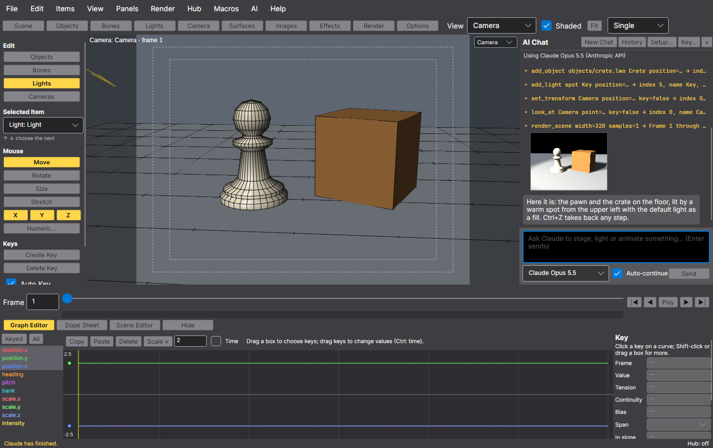

| Tools | |
|---|---|
| The engine's scene tools (51) | `get_scene`, `get_keys`, `new_scene`, `open_scene`, `save_scene`, `export_scene`, `add_object` (a file), `add_light`, `add_camera`, `add_null`, `add_bone`, `remove_item`, `set_item`, `set_transform`, `look_at`, `set_key` (tension, continuity, bias, and a span: `tcb`, `linear`, `stepped` or `bezier` with `in_slope` and `out_slope`), `delete_key`, `set_end_behavior`, `set_follow_path`, `bake_path`, `shift_keys`, `scale_keys`, `set_scene`, `undo_scene`, `redo_scene`, `render_scene`, `render_scene_view`, `render_animation`, `make_movie`, `set_morph`, `remove_morph`, `add_displacement`, `set_displacement`, `remove_displacement`, `skelegons_to_bones`, `set_ik`, `bake_ik`, `add_motion_modifier`, `set_motion_modifier`, `remove_motion_modifier` (lag, jitter, cycle, oscillate), `set_lens_flare`, `set_volumetric_light`, `set_shadow_map`, `set_dissolve`, `load_image`, `remove_image`, `set_compositing`, `set_particles`, `set_hair`, `comb_hair`, `set_soft_body` |
| Conveniences (1) | `camera_bookmark` (save, recall, remove or list named camera views kept with the scene) |
| Making objects (7) | `make_object` (box, ball, cylinder, cone, disc, torus, ground, steps or text, with its own surface, standing on its base), `build_object` (any object from the engine's modeling calls, as steps, on an object of its own), `edit_object` (the same steps on an object in the scene, its motion kept), `set_object_surface` and `get_object_surfaces` (an object's look, procedural textures too), `list_modeling_tools` and `describe_modeling_tool` |
| Motion in a phrase (2) | `animate` (moves written as ordinary keys, one undo step for a whole sequence: move, turn, grow, bounce with squash and stretch, spin, orbit, sway, bob, shake, pop in and out, fade in and out, through points, track, dolly, truck, crane, push in, follow; each with a span that can follow or run with another move, and an ease), `camera_move` (dolly, push in, orbit, crane, truck, follow or handheld, keeping a target in view) |
| Whole shots (3) | `build_scene` (a whole shot from one plan: settings, objects, a lights rig or lights, the camera, any scene calls, motion and camera moves, one undo step, all or nothing, checked at the end), `frame_items` (the camera placed to fit items from a direction, at a frame, over a span or following them), `check_shot` (what to fix before rendering, frame by frame: out of view, cut off, too small, below the ground, overlapping, unlit, camera inside, keys after the end) |
| AVALightWave's own (13) | `replace_object` (Replace Object, one undo step), `save_object` (an object to a file in the working folder), `edit_in_modeler` (the hub; in the open window), `hub_status`, `clone_item` (copies offset in place and time), `load_from_scene` (another scene's items, names kept apart), `add_morph_target` (a target from a file or another object), `load_motion` and `save_motion` (.mot files), `make_preview` (a flipbook of PNGs, or a movie), `queue_render` and `render_queue_status` (the render queue or a farm folder), `run_macro` (a Lua scene macro, one undo step, paths kept in the working folder) |

77 tools in all. Recipes (MCP prompts, 18), step-by-step plans with the exact calls. Six make their scenes from
nothing with `build_scene`: `ball_from_nothing` (a ball bouncing across a floor with squash and stretch),
`solar_system` (planets orbiting a glowing sun, one with a moon), `product_reveal` (a gem popping onto a pedestal under
studio light, the camera pushing in, a spot sweeping), `domino_run` (a row toppling in turn, each over its front
edge), `rocket_launch` (a rocket built from modeling steps climbing on a plume of smoke) and `dancing_shapes` (five
shapes dancing to a shared beat). The rest start from object files: `stage_object` (load, light from
three sides, frame, render), `object_turntable` (a null turning once, rendered to frames and a movie), `camera_flyby`
(the camera on a path through nulls, keyed to keep the object in view), `light_sweep` (a spot fading in, turning
across and out), `render_on_farm` (a turntable sent to a farm folder as a job), `clone_stagger` (a bouncing object
cloned into a row, each bounce later, checked with a preview), `light_beams` (a volumetric spotlight with a shadow map
and a lens flare), `composite_shot` (a background picture, a keyed foreground and an object dissolving in),
`rig_from_skelegons` (the sample arm rigged in one step and keyed with Bezier, stepped and TCB keys),
`follow_and_jitter` (lag, jitter and oscillate modifiers, and a motion carried in a .mot file), `morph_and_macro` (a
morph envelope, and a Lua macro ringing the object with crates), and the engine's `three_point_lighting`.

## Download and run

Ready-to-run builds for Windows, macOS and Linux, on Intel/AMD and ARM, are on the
[Releases page](https://github.com/Harlock123/AVALightWave/releases/tag/latest). **Latest build** is rebuilt on every
push to `main`. Each download is one self-contained executable: no .NET install is needed.

```bash
tar -xzf AVALightWave-linux-x64.tar.gz     # or linux-arm64, linux-arm, osx-arm64, osx-x64
./AVALightWave                             # or ./AVALightWave showcase.lws, or an object file
```

On Windows, unzip and run `AVALightWave.exe`. On macOS, if Gatekeeper refuses to open it, run
`xattr -d com.apple.quarantine AVALightWave` once. Put AVA Modeler beside it (or say where it is in Options) for Edit
in Modeler to start it.

## Using it

| | Mouse | Keys |
|---|---|---|
| Choose | Click an item in the view (of the edit mode), a name in a panel's list or the Scene Editor | Shift+O, Shift+B, Shift+L, Shift+C the edit mode; ↑ ↓ the next item |
| Move it | Drag in the view; the right button works the third axis | T Move, Y Rotate, H Size, Shift+H Stretch; N Numeric |
| Animate | The timeline; the graph editor; the dope sheet | Enter Create Key, Delete Delete Key; ← → a frame, Home, End; Space play |
| Look | Wheel zooms; middle-drag (or Alt-drag in a flat view) pans; Alt-drag turns the perspective view | 1 to 6 the views, A fit; G graph editor, D dope sheet, E Scene Editor |
| Files | File menu, Recent Scenes and Recent Objects | Ctrl+N, Ctrl+O, Ctrl+S, Ctrl+Shift+S, Ctrl+Q |
| Views | Click a pane to make it the active one; its corner list sets its view | Ctrl+1 single, Ctrl+2 side by side, Ctrl+3 stacked, Ctrl+4 quad; 1 to 6 the active pane's view; A frames every pane |
| Elsewhere | | Ctrl+E Edit in Modeler, F4 AI Chat, F9 render, F10 animation, Shift+P Make Preview; Ctrl+Z undo, Ctrl+Shift+Z or Ctrl+Y redo |

`samples/` has objects (a pawn, a crate, a ball, a floor, the engine's spaceship, an arm with skelegons and the pawn
squashed as its morph target), images (a sky, a keyed foreground frame and a numbered sequence) and a showcase scene as
.lws and .avascene; `dotnet run samples/make_samples.cs` makes them again with the engine's tools.

## Building and testing

The engine is a submodule, so clone with it:

```bash
git clone --recursive https://github.com/Harlock123/AVALightWave.git    # or: git submodule update --init --recursive
dotnet build AVALightWave.slnx
dotnet run --project src/AVALightWave
dotnet test AVALightWave.slnx
```

It needs the .NET 10 SDK. AVALightWave's own tests (the engine's are in its repository):

| Tests | Count | What they cover |
|---|---|---|
| Core | 68 | The scene document: a new scene; objects of every format, several to a scene; .lws saved with an object that had no file written beside it, and loaded back with its motion and parent; .avascene keeping hidden and locked items with the meshes inside; a missing object's placeholder; the sample scenes; Replace Object keeping motion and bones, with undo, and keeping a chosen name; surfaces changed as undo steps and saved; Save Object by extension; hiding, locking and parenting as steps. Edit modes and stepping through items; the Scene Editor's hierarchy (bones under their object), flags and keys. Settings saving only where loaded from. The hub both ways with a stand-in AVA Modeler on pipes of the tests' own: Edit in Modeler by file and by a copy, a refusal, starting AVA Modeler (faked) when it isn't there, a save updating the linked object (under a new name) keeping its motion as one undo step, a save with no link updating every object from that file, Send to AVALightWave adding then updating, hello, refusals and a second copy on the same pipe; live updates (`object_changed`) merging into one undo step and keeping the object's file, and the hub's status following AVA Modeler. Clone Item (motion, bones, offsets in place and time, one undo step, refusals, names), Load from Scene (hierarchy, motion, renamed clashes, lights and cameras left out, a broken file changing nothing), auto-save and recovery (only changes, the scene left as it was, recovered untitled with its unsaved objects, a clean exit); morph targets from files and objects with keyed weights; Lua scene macros (the API, one undo step, all or nothing, the sandbox and time limit, files and the macro folder); Make Preview (frames and timing, motion, shaded and wireframe, no selection box, frame shape, the memory cap, a copy of the scene, cancelling, PNGs, a movie without ffmpeg) and the view layouts' settings; the render farm (sending a job copies the scene and its images, one node and two nodes sharing a job with no frame rendered twice, a dead node's claim taken over, cancelling, ordering, a job pointing outside its folder refused with nothing outside read, malformed jobs, the command line, the local queue, real paths and links); the showcase drawn with OpenGL against software, on a real context where there is one |
| Mcp | 53 | The Layout server: exactly the scene tools and its own, none of the engine's modeling tools served as such, its instructions, descriptions and recipes; every make_object shape closed, facing outward and standing on its base, with its surface; build_object running the engine's modeling calls and naming a failing step, edit_object on a copy (motion kept, undo putting it back), set_object_surface with a procedural, a made object rendered and kept in an .avascene, every mistake changing nothing; animate's eases and sequences (one undo step), bounces that never sink and squash on landing, spin, orbit and track keeping their geometry, through, pop, fade, sway and shake, a wrong move named and changing nothing, and camera moves keeping their target in view; a build_scene plan made in one undo step, rendered and taken back, a failing part named and changing nothing, frame_items fitting at a frame, over a span and following, and check_shot finding a sunk, unseen, unlit object, late keys and a camera inside a box; add_object needing a file; replace_object (motion kept, undo, its mistakes changing nothing); save_object inside the working folder (overwrite, formats) and an .lws referring to it; the hub tools headless and with a window; `AVALightWave --mcp` headless and its help; the chat's prompt and core tools; clone_item, load_from_scene, add_morph_target, save_motion and load_motion, run_macro and make_preview, each with errors that change nothing and kept to the working folder; queue_render and render_queue_status; every recipe (18) followed call by call through the server, its last picture not blank and its result checked |
| UI | 52 | The window headless: its start, edit modes and what the view picks, keys (frames, items, mouse modes, views, Enter, Ctrl+Z), axes, the numeric requester, every panel (a spot added, frames and resolution typed, each an undo step), the Bones panel adding bones to the current object, the Options panel joining the hub and letting agents in, the Surfaces panel, the Scene Editor's eye, lock and names, files through the menus' commands (Load Object, Save Scene, Replace Object, recent files, a missing scene), dragging in the view; the hub end to end (Ctrl+E to a stand-in AVA Modeler, its save updating the scene live, Ctrl+Z, Send to AVALightWave, live sync and the hub light); an agent through AVALightWave's own live pipe; the AI Chat against a fake Anthropic API (no real calls); Clone Item's requester, Load from Scene, crash recovery, the morph panel, Skelegons → Bones, Motion Options and motion files, the Macros menu; the Lights panel's shadow maps, flares and beams, dissolve, the Images panel and compositing; the view layouts (one, two or four panes, each pane's view, the active pane and its keys, modes in every pane, picking and dragging, remembered), the panes' OpenGL falling back to software; the preview window (Shift+P, stepping and looping, playing, saving); the Render Queue (sending, rendering here, cancelling, a farm folder, a real `--render-node` process); and the README's screenshots |

The screenshots are drawn by the tests in a real (headless) window:

```bash
AVALIGHTWAVE_SHOTS=$PWD/Images dotnet test tests/AVALightWave.UI.Tests --filter Screenshot
```

## How it's built

| Project | What it is |
|---|---|
| `AVALightWave.Core` | The scene document (`SceneDocument`: the engine's `LayoutSession` with scenes, objects, Replace Object, surfaces, hiding, locks, the hub's links and live updates), Clone Item, Load from Scene, auto-save and recovery, morph targets, Lua scene macros, Make Preview, the view layouts' settings, the render farm and its nodes, the Scene Editor's outline, edit modes, settings, and AVALightWave's end of the hub (`LightWaveHub`). No UI |
| `AVALightWave.Mcp` | The Layout-only MCP profile of the engine's server, AVALightWave's own tools and recipes, and the chat's prompt. No UI |
| `AVALightWave` | The window, its panels (Images among them), the view layouts and their OpenGL surfaces, the Scene Editor, the requesters (numeric, Clone Item, Load from Scene, Motion Options), the preview window, the Render Queue, the Macros menu, `--render-node`, live agents and the AI Chat |
| `external/AVAModeler` | The engine, as a git submodule: AVA Modeler's Core, Formats, Geometry, Rendering, Scene, Layout, Layout.UI, Mcp, Chat, Chat.UI and Hub projects, referenced as they are (one copy, never forked) |

Reused from the engine: the scene model and its undo (merged steps for live sync), copying items between scenes,
envelopes with their spans and keying, motion modifiers and .mot files, bones and IK, paths, morphs and displacements,
LWS/LWO/glTF and every object format, the ray tracer and its effects (lens flares, volumetric lights, shadow maps,
dissolve, compositing, the image list), animation rendering and movies, the Layout view (`SceneView`) and its OpenGL
renderer and surface, the software renderer previews are drawn with, the item panel (`ItemPropertiesPanel`), the graph
editor, the dope sheet, the scene settings, the render and animation windows, the Lua macro sandbox, the MCP server and
its live pipe, the chat and its panel, and the hub's wire. New here: the standalone document, the window and its
panels, the Scene Editor, the requesters, Clone Item, Load from Scene, auto-save, morph targets from files, Lua scene
macros, Make Preview, the view layouts, the render queue and farm, the Layout-only server with its tools and recipes,
and AVALightWave's end of the hub.

## Known limits

- Record (Layout's record-to-device) has no panel. Textures are edited in AVA Modeler (Edit in Modeler); the Surfaces
  panel sets the rest of a surface. The views show a sequence texture's base image (renders play the sequence).
- **OpenGL views**: where OpenGL can't start (no driver, a remote session), the panes go back to software drawing about
  two seconds after the window opens; OpenGL lines are 1 pixel where the software's are 1.5, antialiased.
- **Clone Item** copies an item and an object's bones, not its children; offsets add to every key of position,
  rotation and scale, and the time offset moves only channels with two keys or more. **Load from Scene** leaves the
  other scene's settings (frames, backdrop, effects, images, compositing) behind and doesn't make its camera current.
- **Auto-save** writes a self-contained .avascene every few minutes (Options; from the next start) only while the scene
  has changes; a recovered scene is untitled, so the first save asks where.
- **Make Preview** is the view's software drawing (grid and item drawings included) of up to 512 MB of frames: a bigger
  one is made smaller, and one under 160 pixels wide is refused. Playback follows a timer, so it isn't frame-accurate
  under load; a preview through the active view is frozen as it was when made, and pixel aspect isn't applied. MP4 and
  GIF need ffmpeg on the PATH.
- **View layouts**: panes can't be maximised in place (switch to Single), splitter positions aren't remembered, and A
  frames every pane rather than the active one.
- **The render farm** compares file times with the local clock to find a dead node, so machines' clocks should agree to
  within a minute (the take-over is after two). Paths are checked when a node loads a job: someone who can write to the
  share could swap a file for a link afterwards, so share the farm folder only with people you trust. Farm jobs render
  with shadows, reflections and transparency on; frames are numbered in render order (`frame0001.png`…); a movie is
  made only by a node with ffmpeg; a failed job isn't retried (remove it and send it again); the farm folder chosen
  isn't remembered; local rendering stops when the folder changes or the window closes; only .avascene jobs (protocol 1).
- **Live sync**: selection changes aren't sent, and a texture's settings alone don't count as a change; an update is
  read on the window's thread when it arrives (instant for everyday objects).
- **Macros** run with Layout's API above (no object modeling: that's AVA Modeler's own macros), and `render` saves a
  PNG of the current frame only.
- **Morph targets** need the same points in the same order; the target's shape is copied when it's added. `.lws` keeps
  no morphs (`.avascene` does).
- Locks (`.avascene` only) keep the mouse off an item, not its numbers, keys or agents. `.lws` keeps neither locks nor
  hidden items, motion modifiers, volumetric lights or a sequence's offset and loop; the engine's own limits (README of
  AVA Modeler: key spans, motion modifiers and motion files, light effects, dissolve and compositing among them) apply
  to scene files, rendering and glTF.

## About and licence

AVALightWave © 2026 Lonnie Watson, under the [MIT License](LICENSE).

LightWave is a trademark of its current owner, LightWave Digital. AVALightWave is an independent project, a
re-imagining inspired by classic LightWave Layout; it isn't affiliated with or endorsed by NewTek or LightWave Digital,
and uses none of their logos, artwork or interface art (its icon is its own, drawn by `tools/make_icon.py`). It reads
and writes the classic object and scene formats for compatibility. It's built on AVA Modeler (MIT), Avalonia,
SkiaSharp and the official MCP and Anthropic C# SDKs.
